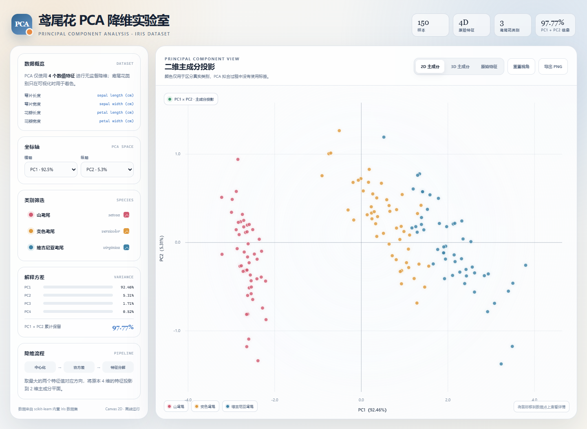

# 鸢尾花 PCA 降维：注释、学习笔记与 HTML5 可视化

本项目基于课程源码 `pca降维.ipynb` 整理，提交内容包括：

1. `pca降维_注释与学习笔记.ipynb`：已执行并保存输出的 Jupyter Notebook，包含逐段注释、PCA 结果、sklearn 交叉验证、图像 PCA 修正实验和工具函数学习笔记；
2. `index.html`：不依赖服务器或第三方 CDN 的 HTML5 交互式可视化；
3. `requirements.txt`：运行 Notebook 所需 Python 依赖。



## HTML5 可视化功能

- 二维主成分投影，可自由选择 PC1–PC4 作为横纵轴；
- 三维主成分空间，支持鼠标拖拽旋转、滚轮缩放和双击复位；
- 原始四维特征空间对照，可选择任意两个原始特征；
- 三类鸢尾花筛选；
- 每个主成分的解释方差比例；
- 将鼠标悬停在数据点上查看样本明细；
- 导出当前可视化为 PNG。

直接双击 `index.html` 即可打开。

## Notebook 运行

```bash
pip install -r requirements.txt
jupyter lab
```

打开 `pca降维_注释与学习笔记.ipynb`，按顺序运行全部单元。

## 主要实验结论

- 鸢尾花数据共有 150 个样本、4 个特征、3 个类别；
- PC1 与 PC2 的累计解释方差约为 **97.77%**；
- 手写 PCA 与 scikit-learn `PCA` 的解释方差一致，主成分向量可按整体符号对齐；
- 二维 PCA 图中 Setosa 与另外两类基本分离，Versicolor 与 Virginica 存在局部重叠；
- 原源码的 `np.mat` 写法已不推荐，现代代码应使用 ndarray 和 `@` 表示矩阵乘法；
- 实对称协方差矩阵可优先使用 `np.linalg.eigh` 进行更稳定的特征分解。

## 数学流程

给定中心化数据 `X`：

1. `C = X.T @ X / (n - 1)`；
2. 对 `C` 做特征分解，按特征值降序排列特征向量；
3. 取前 `k` 个特征向量组成投影矩阵 `P`；
4. 主成分坐标 `Z = X @ P`；
5. 重构数据 `X_hat = Z @ P.T + mean(X)`；
6. 解释方差比例 `lambda_i / sum(lambda)`。
